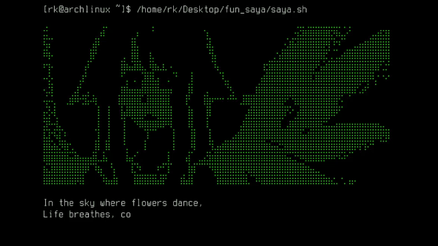

# Saya Terminal Lyrics 🌿

A small Bash script that displays green ASCII art of Saya in the terminal, plays the audio file, and types lyrics.




## Usage

1. Clone the repository:
   ```bash
   git clone https://github.com
   cd repo-name
   ```

2. Make the script executable:
   ```bash
   chmod +x saya.sh
   ```

3. Run it (make sure `16.mp3` is in the same directory):
   ```bash
   ./saya.sh
   ```

## Requirements
- Linux / Unix terminal with UTF-8 and ANSI color support
- `bash`
- `xdg-open` (for playing the `.mp3` file)

## Credits
- **ASCII Art:** [METTLEMOUTH](https://www.instagram.com/METTLEMOUTH/) (VGen, Instagram, TikTok)
